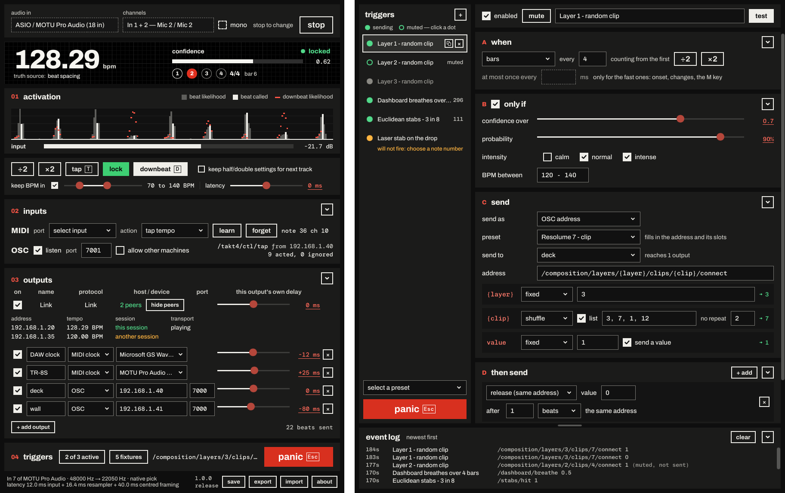

# takt4



takt4 listens to incoming audio (WASAPI, ASIO, Core Audio, ALSA, JACK), finds the beat, downbeat and tempo (or takes them from an Ableton Link session, a MIDI clock or the DJ's CDJs), and sends them to the rest of
your rig: **Ableton Link, OSC, MIDI clock, MIDI notes and Art-Net (DMX)**. Plus optional built in triggers to fire clips,
cues, notes, lights, lasers etc exactly on time with whatever audio you feed it. No manual tapping, locks on to new songs automatically

## Get it

From the **[latest release](https://github.com/Fohdeesha/takt4/releases/latest)**:

- **Windows 10 or 11**: `takt4.exe`, plus the latest [Visual C++ Redistributable (x64)](https://aka.ms/vc14/vc_redist.x64.exe). Not code-signed: if Windows "protected your PC", click **More info**, then **Run anyway**
- **macOS 12 or later**, Intel or Apple Silicon: `takt4-macos.zip`. Unzip and open **takt4**. Not notarized: the first time, macOS won't open it. Go to **System Settings > Privacy & Security** and click **Open Anyway**. Allow the microphone (your audio input) and the local network (Link, OSC, Art-Net) when asked
- **Linux x86_64**, Ubuntu 22.04, Debian 12 or newer: `takt4-linux-x86_64.tar.gz`. Unpack and run `takt4`. Needs `sudo apt install libasound2 libjack-jackd2-0 libfontconfig1 libfreetype6` (or your distro's equivalent; PipeWire's JACK works). **import** and **export** need `zenity`, or `kdialog` on KDE
- The Mac and Linux builds are new and haven't been tried on real hardware yet

## Quick start

1. Pick your device and input channels at the top (a stereo pair; tick **mono** if you have one input). Click **start**
2. Give it a few bars. It says **locked** when it's sure, and nothing goes out to the rig until then. Until it hears a beat it says **no beat**, so an intro, a pad, a crowd or someone talking doesn't set anything off. A busy track can keep it there a few seconds longer: **tap** or **downbeat** tells it there is a beat
3. Under **outputs**, tick **Link**, or click **add output** and pick its **protocol**: OSC, MIDI, MIDI clock or Art-Net (DMX)
4. In the **triggers** row, click **add a rule**. Pick a ready-made set from **select a preset**, or build your own.

## If the beat is wrong (rare)

- BPM correct, but start of the count/downbeat isn't: press **downbeat** (or **D**) on the one
- Half or double speed: **÷2** or **×2**. The button stays lit and the tempo says **÷2 applied** while it's in effect
- If the number and the beat dots disagree, the line under the tempo says what the beats are going out at and which of **÷2** / **×2** matches them
- Keep it in a range: tick **keep BPM in** and set a rough range
- **tap** (or **T**) to tap it in
- **latency** moves everything earlier or later to compensate for input, output, and overall rig latency

## Taking the beat from Link, a MIDI clock or the CDJs

If the DJ already has the tempo, takt4 can take it from there instead of listening: an Ableton Link session (rekordbox, Traktor, Serato, Engine DJ, Live), a MIDI clock (a DJ mixer, a DAW), or Pioneer CDJs on a Pro DJ Link network.

- Open **inputs**, and in the **timing** row pick **from**: **Ableton Link**, **MIDI clock** (then its **port**) or **CDJs (Pro DJ Link)**. Only while stopped. Click **start**
- The audio isn't used at all: the top says **timing from Ableton Link** and **audio not in use**, and **01 timing** shows the beats as they come in
- **Link**: takt4 joins the session as one more peer and never changes its tempo. The **Link** output says **following — not sending**
- **MIDI clock**: the bar starts on the clock's **Start**. A DJ mixer sends none until its start button is pressed; until then, press **downbeat** (or **D**) on the one
- **obey start/stop**: tick it for a DAW, so its Stop stops the beats. Leave it off for a mixer, whose stray Stop shouldn't black out the rig
- A clock that stops and starts again on a Start picks up on its first tick, at the tempo it had
- **CDJs** (experimental: not yet tried with real CDJs): cable this computer into the DJ's Pro DJ Link network, the mixer's or the switch's. At **start** takt4 joins as player 7 or higher and takes each beat the tempo master plays, with the bar from the DJ's beat grid. While the master is paused, takt4 follows the one other deck that's playing. With a Pioneer mixer that reports which channels are on air, a deck has to be on air to be followed, the master included. Pick a deck under **follow** if the DJ doesn't use the master button. Cue presses aren't beats. rekordbox can't run on the same computer, as it uses the same ports
- **network card** (CDJs): **automatic** joins on the card a CDJ is heard on, and the list marks it. Pick a card if the computer has more than one that reaches the DJ's network; it's found again if its address changes. Only while stopped; it's joined at **start**. A card picked on another computer (settings beside a copy of takt4 on a shared drive) stays on the list as **not on this computer**, and takt4 joins on the card the CDJs are heard on instead
- The first time, Windows asks whether takt4 may use the network: allow **Public** networks too. A DJ network with no router counts as Public, and Link and the CDJs can't be heard through a blocked one
- If the source goes, the beats carry on for 4 seconds, then stop, as they do when the audio goes quiet
- **÷2**, **×2** and **downbeat** work; **tap** and **lock** are off. **latency** is kept separately for each source
- Rules on onsets or intensity can't fire without the audio. The rule editor says which

## Triggering stuff from the tracked audio (Rules)

If you just need a solid BPM feed for an Ableton Link session, DJ equipment, or similar, you're done. However takt4 has a powerful built in triggering system if you want to drive gear from your music feed (lighting, lasers, video, samplers, etc).
Enter the rule editor (the **triggers** window). **+** adds a rule. Each rule has four sections:

- **A when**: every N beats or bars, the downbeat, an onset, a tempo change,an intensity change, etc
  - Bars fire **on beat** 1 to 16 of the bar
  - Tick **then wait** to send it so many ms, beats or bars after the trigger
- **B only if**: confidence, probability, intensity, BPM range, other filters 
- **C send**: an OSC address, a MIDI note, note off, CC, program change or pitch bend, or DMX values. **send to** picks the outputs; DMX picks fixtures under **lights** instead
- **D then send**: follow-ups (a clip release, a note off, etc) after so many ms, beats or bars

Each `{slot}` in an OSC address gets a value: shuffle (no repeats until all have played), random, cycle, weighted, fixed, a live value (BPM, bar, confidence...) or a ramp. The **preset** box fills in Resolume, TouchDesigner, MadMapper and QLC+ addresses

- Click a rule's dot to mute it
- **test** fires it once
- The **event log** along the bottom shows everything that goes out over the wire
- **panic** (or **Esc**, in the main window or the rule editor) stops every rule until **release** is pressed

## Delays

- One **latency** slider for the rig, plus a delay per output. They add together
- Positive is later, negative is earlier. Once locked, a −300 ms output really gets its cue 300 ms early
- Your settings here will almost always be negative: audio input, detection, and your destination apps all add latency that needs to be removed
- Click any underlined number to type a value instead of using the slider
- Right-clicking any slider puts it back to default

## OSC

takt4 sends the below global data to all OSC outputs you tick under **/takt4 global messages to**, at the right of the **outputs** heading. None get it until you do. These are separate from triggers/rules.

```
/takt4/bpm         float   the tempo
/takt4/bar         int     which bar, on each downbeat: 1 on the first after start or a silence
/takt4/phrase      int     which bar of its phrase, on each downbeat: 1 on bars 1, 9, 17 in phrases of 8
/takt4/beat        int     1, on every beat
/takt4/beat/bar    int     which beat of the bar, 1..N
/takt4/downbeat    int     1, on downbeats
/takt4/confidence  float   0 to 1
/takt4/locked      int     0 or 1
/takt4/meter       int     beats per bar
/takt4/phrase_len  int     the bars in a phrase, set by "in phrases of" in the outputs heading
/takt4/intensity   int     0 calm, 1 normal, 2 intense
/takt4/resync      int     1, when the tracker has just found itself again
```

`/takt4/bar` and `/takt4/phrase` go just before their downbeat's `/takt4/beat`. The rules count bars the same way, so "every 4 bars" fires on bars 1, 5, 9…

They go out only while takt4 is running and locked: nothing while it hunts or is stopped. When the lock is lost, and at **stop**, `/takt4/locked 0` goes out once.

Each beat also sends `/takt4/beat/timing`: a float, the ms since the beat was meant to land (its moment plus the latency, so an output's own delay shows in it); a float, the ms until the next beat; and an int, the run's beats so far. A show controller can schedule from these, so a late or lost datagram costs it nothing.

You can *control* takt4 over OSC as well, tick **listen** on the OSC row under **inputs**:

```
address                       send           does
/takt4/ctl/tap                nothing or 1   tap the tempo
/takt4/ctl/downbeat           nothing or 1   the one is now
/takt4/ctl/tempo/halve        nothing or 1   ÷2
/takt4/ctl/tempo/double       nothing or 1   ×2
/takt4/ctl/lock               1 or 0         pin the lock (1), or let it go (0)
/takt4/ctl/panic              anything       panic
/takt4/ctl/panic/release      nothing or 1   release
/takt4/ctl/manual             nothing or 1   fire the manual rules
/takt4/ctl/bar                a number       this bar is bar n, so the next downbeat is n + 1
/takt4/ctl/rule/<id>/enable   1 or 0         switch a rule on (1) or off (0)
/takt4/ctl/rule/<id>/mute     1 or 0         mute (1) or unmute (0) a rule
/takt4/ctl/rule/<id>/double   nothing or 1   fire half as often
/takt4/ctl/rule/<id>/halve    nothing or 1   fire twice as often
/takt4/ctl/rule/<id>/rate     a number       multiply its count, 0.0625 to 64 (2 = half as often), for a fader
/takt4/ctl/rule/<id>/reset    nothing or 1   back to the count it was written with
```

- Send the value as the first argument: an OSC **int** (`i`), **float** (`f`) or **boolean** (`T` is 1, `F` is 0). A string counts as nothing; any other type and the message is ignored
- **nothing or 1**: a button. Any number but 0 presses it too; a 0 is its release and does nothing, so a push button that sends 1 then 0 presses once. **panic** engages on anything, 0 included
- **1 or 0**: a switch, never a toggle, so a missed message can't leave one backwards. Anything but 0 is on; with no value it's ignored
- `<id>` is the rule's id, shown beside its name in the rule editor, or `all`
- A bundle's messages are each acted on as they arrive; its time tag isn't waited for
- **tap** and **lock** do nothing while takt4 follows Link, a MIDI clock or the CDJs, and count as ignored
- From this computer, send to `127.0.0.1`, not `localhost`: takt4 listens on IPv4 only
- Ticking **allow other machines** makes Windows ask whether takt4 may use the network: allow **Public** networks too if the controller is on a network with no router

### Status and remote setup, for a show controller

Every output ticked for the global messages also gets takt4's status, sent from the thread that sends the beats:

- **Once a second**, whatever the audio or the window is doing: `/takt4/status/alive` (an int that counts up), in one bundle with the whole status. Each value is its own address, `/takt4/status/<name>`: `running`, `locked`, `hunting`, `state` (the word on the tempo panel), `confidence`, `bpm`, `level` (dBFS), `load` (the slowest audio callback of the last second, as a share of its buffer's time: 1 leaves no time to spare), `dropouts`, `source` (`audio`, `link`, `midi-clock` or `prolink`), `source_ok`, `source_detail`, `panic`, `audio/host`, `audio/device`, `audio/channel`, `audio/mono`, `audio/rate`, `latency_ms`, `version`, `uptime_s`, and `ui_age_ms` (how long ago the window last updated it)
- **Within a tenth of a second of a change**: that value again, on its own (not the level, the load, `uptime_s` or `ui_age_ms`, which go once a second); `source_detail` goes again just before any change of `source_ok`, so the reason is there first
- **What the status line says**: `/takt4/status/log` with a string level (`info` or `warning`) and the text, 5 lines a second, the rest after them

With **listen** on, a controller can ask for these. The answer goes to the address and port it sent from:

```
/takt4/ctl/status          the whole status, as one bundle
/takt4/ctl/audio/devices   one /takt4/status/audio/device (host, device, inputs) per input, then /takt4/status/audio/devices (how many)
/takt4/ctl/outputs         one /takt4/status/output (id, name, kind, host, port, on, delay ms, global, problem) per output, then /takt4/status/outputs (how many)
```

To let a controller *change* takt4, tick **allow remote setup** on the line under the OSC row. It's off by default; for another computer, **allow other machines** has to be ticked too. **only from** takes IPv4 addresses (this computer is always allowed); leave it empty for any. Each change is made the way the window makes it, saved like one made in the window, and shown on the status line with who sent it:

```
address                               send                                does
/takt4/ctl/audio/start                nothing                             start; "running already" if it is
/takt4/ctl/audio/stop                 nothing                             stop
/takt4/ctl/audio/restart              nothing                             reopen the audio input
/takt4/ctl/audio/device               host, device (strings)              pick the input, by the names audio/devices gives (stopped only)
/takt4/ctl/audio/channel              input (int, from 1), mono (1 or 0)  pick the input channel, from 1; in stereo a pair starts at an odd input; mono can be left off unless a request number follows (stopped only)
/takt4/ctl/source                     audio, link, midi-clock or prolink  where the beats come from (stopped only)
/takt4/ctl/output/add                 name, kind, host (strings), port    kind is osc, artnet, midi or midiclock (a MIDI output's name as host, port 0); the reply's note is the new output's id
/takt4/ctl/output/<id>/enable         1 or 0                              switch an output on or off
/takt4/ctl/output/<id>/delay          ms (a number)                       its delay
/takt4/ctl/output/<id>/global         1 or 0                              send it takt4's global messages (OSC outputs only)
```

- Add a request number as one more int on any of these, the three questions included, and takt4 answers `/takt4/reply` with the number, `ok` or `refused`, and a note. Without one, it only answers a refusal: `/takt4/status/refused` with the address and why
- A change is refused, with the reason, while a dialog is open in takt4 ("busy"), while a start or stop is under way, and when it can't be done
- To restart takt4 from another program, end the running one first: a second launch only brings the first one to the front. Set the environment variable `TAKT4_NO_CRASH_DIALOG=1` so that after a crash takt4 writes its report and ends, instead of showing a message that waits for someone to answer it

**MIDI control**: on the MIDI row under **inputs**, pick your controller and an action, click **learn**, hit the midi button you want to use. Available actions: tap, downbeat, halve, double, lock, panic, release, fire the manual rules. A pad bound to lock pins it only while held

## Lights / DMX

1. **add output**, set its **protocol** to Art-Net and type the node's IP
2. Click **patch lights** in the triggers row, then **+** to add a fixture: name, group (optional), universe, **start address** (the one on the fixture), and the nearest **mode** (dimmer, RGB, RGBW, dimmer + RGB, LED par, 8- or 16-bit moving head, Liberation zone). Or click **import** and pick a GDTF (`.gdtf`) or Open Fixture Library (`.json`) file: choose its mode, how many and where, and they arrive with every channel named and set up
3. **identify** flashes the fixture; a channel's **test** holds it at the **test sends** level for 3 s
4. In a rule, set **send as** to DMX / Art-Net and pick an effect: level / fade, color, flash, pulse, strobe, hue sweep, position, path, home, blackout, Liberation clip

- Every effect ends with its duration, so nothing is left strobing etc
- Colors come from a palette (the picker lights the real lamps as you drag)
- A moving head's **how far it moves** keeps random positions and paths inside the range you set
- A fixture with several heads moves them all. In a rule, tick which **heads** move, and slide **spread** to stagger them; a second rule can move the others
- **panic** freezes the lights where they are; **stop** and quitting black them out

## Lasers ([Liberation](https://liberationlaser.com/))

1. Open the rules (**add a rule** or **edit rules** in the triggers row), then **select a preset** > **Liberation: lasers…**
2. Fill in the prompt: how many **lasers** (1 to 4), **Liberation's IP** (127.0.0.1 on this computer) and **port** (6454 unless you changed it in Liberation), where the **first zone** is in Liberation's universe numbering, and each laser's **clips from** and **to** as Liberation names them (`21-1`). Every clip between the two, in Liberation's deck order
3. **add** patches a Liberation zone per laser, adds an Art-Net output to Liberation, switches Link on and adds a trigger per laser: every beat, 2 beats, bar and 2 bars to start. Tick **also move each laser** for a circle, figure 8, sweep or random spots, as far as you set from the center
4. In Liberation, do what the prompt lists: DMX Input on with Art-Net, one Extended 32ch profile per laser at the addresses it shows, tempo source set to Ableton Link

- A clip arms its zone and sets its intensity. **stop**, quitting, **panic** and **no signal** (the input silent for 4 s) disarm every laser. So does muting or switching off its rule. Unticking or deleting an Art-Net output sends it zeros for 3 s, so its lights go dark and its lasers disarm
- Nothing fires until takt4 has a lock

## Saving

- Everything saves by itself to `settings.json` next to `takt4.exe` (next to `takt4.app` on a Mac, or in `~/Library/Application Support/takt4` until the app is moved out of the folder it was downloaded to)
- **export** / **import** carry everything: rules, outputs, lights, tempo settings, the audio input, MIDI and OSC control with what was learned, and which sections are folded. Import replaces it all. An input that isn't on this machine stays the one saved; **rescan** or the next launch finds it once it's plugged in
- A rule's mute and its ÷2 / ×2 status aren't saved
- A `settings.json` written by a newer takt4 isn't saved over until you press **save**
- One takt4 runs per folder: starting it again brings the open one to the front

## How well it tracks

Multiple training sets, bolstered on off-kilter electronic music that trackers usually die on. Beat and downbeat F-measure (`mir_eval`, 70 ms) with the weights that ship:

| tested on | beat | downbeat |
|---|---|---|
| 23 handpicked difficult electronic tracks vs Beat This! | 0.84 (0.92 where two references agree) | 0.66 |
| GiantSteps, 664 Beatport previews | tempo within 4% on 86% | |
| Ballroom, 698 clips, counted in 3 and 4 | 0.95 | 0.93 |

## Building it from source

You don't need to, but if you want to:

- CMake 3.28+, `git clone --recurse-submodules`, and Visual Studio 2022 (C++20) on Windows, Xcode's command line tools and Ninja on macOS, GCC 12+ and Ninja on Linux (with `libasound2-dev libjack-jackd2-dev libfontconfig-dev libfreetype-dev`)
- For the UI: rustup (version pinned in `rust-toolchain.toml`), `curl` on `PATH`, Python 3. The `*-core` presets build the engine, `takt4-cli` and the tests without them
- Network access on the first build, for the pinned, hash-checked dependencies

```sh
cmake --preset windows-msvc        # or macos, or linux
cmake --build --preset windows-msvc
ctest --preset windows-msvc
```

- The default tests stay off your audio, MIDI and network. `windows-msvc-all` runs everything: close anything using your interface first
- `windows-asan` runs the suite under AddressSanitizer; `linux-tsan` (Linux only) under ThreadSanitizer

## License

- GPLv3: [LICENSE](LICENSE). Third-party licences: [THIRD-PARTY-NOTICES.txt](THIRD-PARTY-NOTICES.txt), also inside the app under **about**
- BeatNet+'s weights, which the shipped model is fine-tuned from, come with no licence stated upstream
- The tests use seventeen ten-second excerpts of commercial recordings, never built into takt4: [tests/data/features/](tests/data/features/README.md) lists them and how to have one removed

*Art-Net™ Designed by and Copyright Artistic Licence. ASIO is a trademark and software of Steinberg Media Technologies GmbH.*
